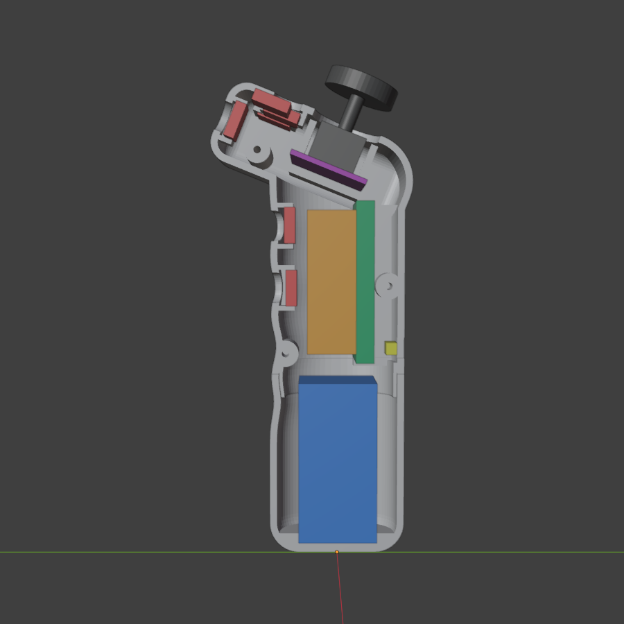

# Extensões do shōbu

## 1. Gamepad, com controle próprio

O jogo funciona inteiro com controle, pela Gamepad API: partida, menu e vibração. Também fizemos
um controle de uma mão para jogar com o celular no óculos de papelão. Ele tem um ESP32 que o
Android reconhece como gamepad Bluetooth, e a carcaça é impressa em 3D
([detalhes](hardware/controle-vr/README.md)).

## 2. WebRTC NxN: chat de voz

Todos na sala falam com todos por WebRTC, via servidor LiveKit, apertando T para falar. A voz é
por proximidade: ela vem da direção de quem fala e some com a distância
([ADR 0026](docs/adr/0026-chat-de-voz.md)).

## Outras extensões

- IA para NPCs: bots completam a sala, com rotas pelo mapa, visão, reação a tiros e três
  níveis de dificuldade ([ADR 0016](docs/adr/0016-bots-no-nucleo.md)).
- Realidade Virtual (VR): celular em óculos de papelão, sem ser WebXR
  ([ADR 0012](docs/adr/0012-cardboard-vr-com-estereo-proprio.md)).
- Multiplayer com 4 jogadores simultâneos
- Servidor autoritativo com predição e compensação de lag: o servidor confere cada tiro
  "voltando no tempo" até o momento em que o jogador atirou
  ([ADR 0002](docs/adr/0002-transporte-de-rede.md)).
- Áudio espacial 3D: tiros, passos e vozes vêm da direção certa no fone.
- Controles de toque para dispositivos móveis
- Matchmaking público e salas privadas
- Mapas
- Otimização gráfica (Qualidade, Equilibrado, Desempenho e Auto)
- Narradores com modelos de voz TTS
- Crédito de tijolinhos da Feira
- Deploy em Kubernetes