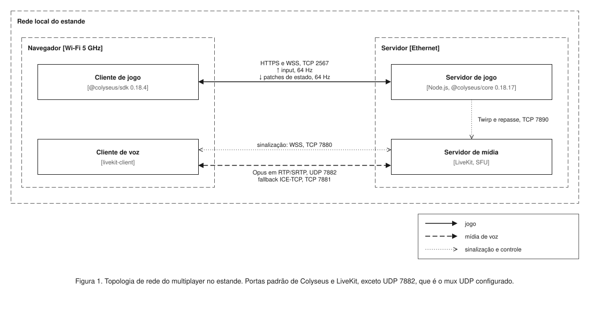
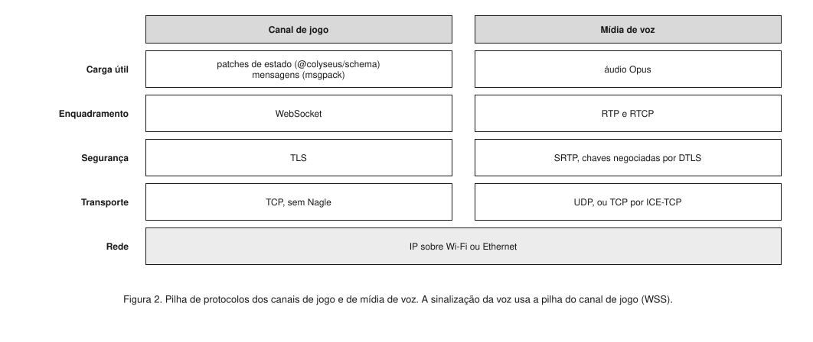
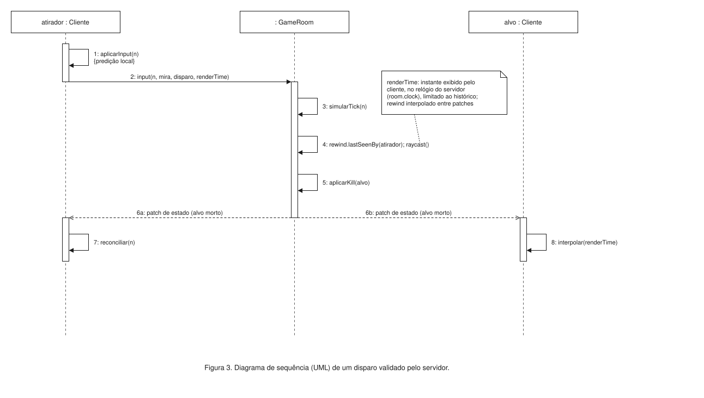
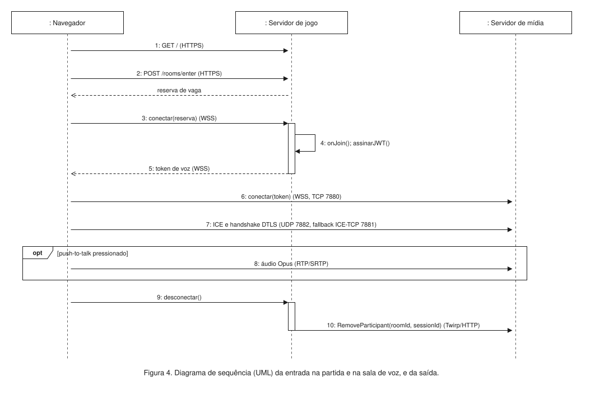

# Arquitetura de rede do multiplayer

Arquitetura de rede do shōbu na feira. As decisões estão nas ADRs
[0002](../adr/0002-transporte-de-rede.md), [0008](../adr/0008-tick-alto-e-sala-de-quatro.md)
e [0009](../adr/0009-chat-de-voz.md). N é o número de jogadores na sala. Nenhum valor abaixo
depende de N ser fixo.

Cada número traz a origem: **padrão** da biblioteca, **configuração** nossa ou **estimativa**
com a premissa declarada.

| Parâmetro | Valor | Origem |
|---|---|---|
| Tick | 64 Hz (15,625 ms) | configuração, `setFixedTimestep(simular, 64)`; o padrão é 60 Hz |
| Envio de patches de estado | 64 Hz | configuração, `patchRate = 1000 / 64`; o padrão é 20 Hz |
| Envio de input | 64 Hz | configuração |
| Heartbeat do WebSocket | ping a cada 3 s, desconecta após 2 sem resposta | padrão do `WebSocketTransport` |
| Tamanho máximo de mensagem do cliente | 4 KiB | padrão do `WebSocketTransport` (`maxPayload`) |
| Áudio | Opus, preset `speech` (24 kbps), quadro de 20 ms, RED e DTX | configuração; o padrão do `livekit-client` é o preset `music`, 48 kbps |

Simulação e patches rodam em dois `setInterval` independentes. A simulação usa acumulador
(`setFixedTimestep`) e faz exatamente 64 ticks por segundo em média. Os patches saem no ritmo
do próprio timer, que no Node 22 mediu 15,24 ms de período médio para 15,625 ms pedidos
(65,6 Hz). Como os dois timers não têm fase comum, um patch às vezes não traz tick novo e o
seguinte traz dois. O intervalo entre patches com tick novo varia de cerca de 15,6 a 31,3 ms, e o
buffer de interpolação de 2 a 3 intervalos absorve essa variação. O rewind não é afetado,
porque o Colyseus grava o histórico em cada patch enviado, exatamente o que o cliente recebeu.

## Topologia

| Origem | Destino | Protocolo | Porta | Conteúdo |
|---|---|---|---|---|
| Cliente de jogo | Servidor de jogo | HTTPS | TCP 2567 | página, matchmaking |
| Cliente de jogo | Servidor de jogo | WSS | TCP 2567 | input, patches de estado, eventos, token de voz |
| Cliente de voz | Servidor de mídia | WSS | TCP 7880 | sinalização |
| Cliente de voz | Servidor de mídia | RTP/SRTP | UDP 7882, fallback ICE-TCP 7881 | áudio Opus |
| Servidor de jogo | Servidor de mídia | Twirp sobre HTTP, loopback | TCP 7880 | `RemoveParticipant` |

*Tabela 1. Conexões de rede. As portas são padrões de Colyseus e LiveKit, exceto UDP 7882,
que é o mux UDP configurado em `rtc.udp_port`. Sem ele, o LiveKit usa a faixa UDP 50000 a
60000.*

Toda conexão que sai do navegador é cifrada: TLS no jogo e na sinalização, DTLS-SRTP na mídia.
O navegador só libera o microfone em contexto seguro, e uma página HTTPS não abre `ws://`. O
`WebSocketTransport` do Colyseus cria um servidor HTTP sem TLS, então o servidor de jogo
recebe um `https.Server` com o certificado da LAN, ou fica atrás de um proxy que termina TLS.

O servidor roda em Linux nativo ou Windows. No WSL2 em modo NAT, o encaminhamento de portas do
Windows (`netsh interface portproxy`) só cobre TCP, e a voz ficaria restrita ao ICE-TCP.

## Pilha de protocolos

O canal de jogo usa TCP porque a rede da feira bloqueia UDP. Sem UDP, todo transporte do
navegador termina em TCP, e o WebSocket direto ao servidor tem menos camadas e menos saltos. A
lib `ws`, usada pelo Colyseus, desativa o algoritmo de Nagle em cada socket
(`socket.setNoDelay()`), e o `WebSocketTransport` desativa `permessage-deflate`. Cada patch sai
no instante em que é gerado, sem agregação nem compressão.

A fragilidade do TCP é a perda de pacote: um segmento perdido retém os seguintes até a
retransmissão (head-of-line blocking). Num fluxo de 64 pacotes por segundo, o segmento seguinte
chega 15,6 ms depois, o receptor responde com SACK, e o RACK-TLP do Linux (RFC 8985) marca a
perda e retransmite. A recuperação típica leva um intervalo entre pacotes mais um RTT, cerca de
20 ms na LAN. No pior caso, com perdas seguidas, ela espera o RTO mínimo do Linux, 200 ms. É
esse caso que o critério de aceite mede com perda simulada.

A mídia de voz usa WebRTC porque o áudio tolera atraso e perda. O RED (RFC 2198) repete o quadro
anterior em cada pacote, e uma perda isolada é reconstruída sem retransmissão.

## Orçamento de banda

Por pacote, o canal de jogo soma IPv4 (20 B), TCP com timestamps (32 B), registro TLS 1.3
(22 B: cabeçalho de 5, tipo de 1, tag AEAD de 16) e cabeçalho WebSocket (6 B do cliente, com
máscara; 4 B do servidor para cargas de 126 B a 64 KiB). Premissas: input de 32 B e patch de
60 B por jogador, a ordem de grandeza do estado quantizado em [nfr.md](../nfr.md).

A mídia de voz soma IPv4 (20 B), UDP (8 B), RTP com extensões (cerca de 24 B) e tag SRTP (16 B
com AES-GCM, 10 B com HMAC-SHA1-80). Um quadro Opus de 20 ms a 24 kbps tem 60 B, e o RED leva a
carga a 125 B.

| Fluxo | Bytes por pacote | Pacotes/s | Banda |
|---|---|---|---|
| Input, cliente → servidor | 32 + 80 = 112 | 64 | 57,3 kbps |
| Patches, servidor → cliente | 60N + 78 | 64 | 512·(60N + 78) bps; 162,8 kbps com N = 4 |
| Áudio de um jogador falando (um fluxo RTP) | 125 + 68 = 193 | 50 | 77,2 kbps |

*Tabela 2. Banda por cliente. Camada de enlace, ACKs puros do TCP e RTCP ficam fora da conta.*

Cada jogador que fala gera um fluxo de áudio, e com push-to-talk o fluxo só existe enquanto a
tecla está pressionada. Um cliente recebe no máximo N − 1 fluxos, um por jogador falando ao mesmo
tempo, e o servidor de mídia emite no máximo N(N − 1). Com o preset padrão `music`, cada fluxo
passaria de 77 para 125 kbps.

No Wi-Fi, o limite prático é a taxa de pacotes, não a banda: cada quadro paga contenção e
preâmbulo independentemente do tamanho. Um cliente envia até 114 pacotes/s e recebe até
64 + 50(N − 1).

## Sequência de um disparo

O cliente aplica o próprio disparo sem esperar a rede (mensagem 1), e o servidor decide o
acerto (mensagens 3 a 5). Cada input leva um `renderTime`: o instante que o cliente exibia, no
relógio do servidor, sincronizado por `room.clock`. Na mensagem 4, `rewind.lastSeenBy` limita
esse instante à janela de histórico e rebobina as cápsulas até ele, interpolando entre ticks. O
servidor não estima o atraso do atirador: o cliente informa o que viu, e o servidor só aceita
instantes dentro da janela.

| Componente | Latência | Origem |
|---|---|---|
| Movimento e disparo do próprio jogador | 0 ms | predição local |
| Ida e volta no Wi-Fi da LAN | 2 a 10 ms | estimativa, a medir |
| Espera até o próximo tick do servidor | até 15,6 ms | 64 Hz |
| Buffer de interpolação dos outros jogadores | 31,3 a 46,9 ms | 2 a 3 intervalos de patch |
| Recuperação de um segmento TCP perdido | cerca de 20 ms; até 200 ms | RACK-TLP; RTO mínimo do Linux |

*Tabela 3. Orçamento de latência na LAN.*

O critério de aceite é o p99 do erro posicional abaixo de 0,10 m ([nfr.md](../nfr.md)), medido
com 2% de perda simulada por `tc netem`.

## Entrada na partida e na voz

O servidor de jogo decide quem está em cada sala. O servidor de mídia só aceita quem traz um
token assinado por ele (mensagem 4), com sala igual ao `roomId`, identidade igual ao `sessionId`
e permissão apenas de áudio. Antes do áudio, o cliente faz as verificações de conectividade do
ICE e o handshake DTLS que deriva as chaves do SRTP (mensagem 7). Quando o jogador sai, o
servidor de jogo o remove da sala de voz (mensagem 10).
