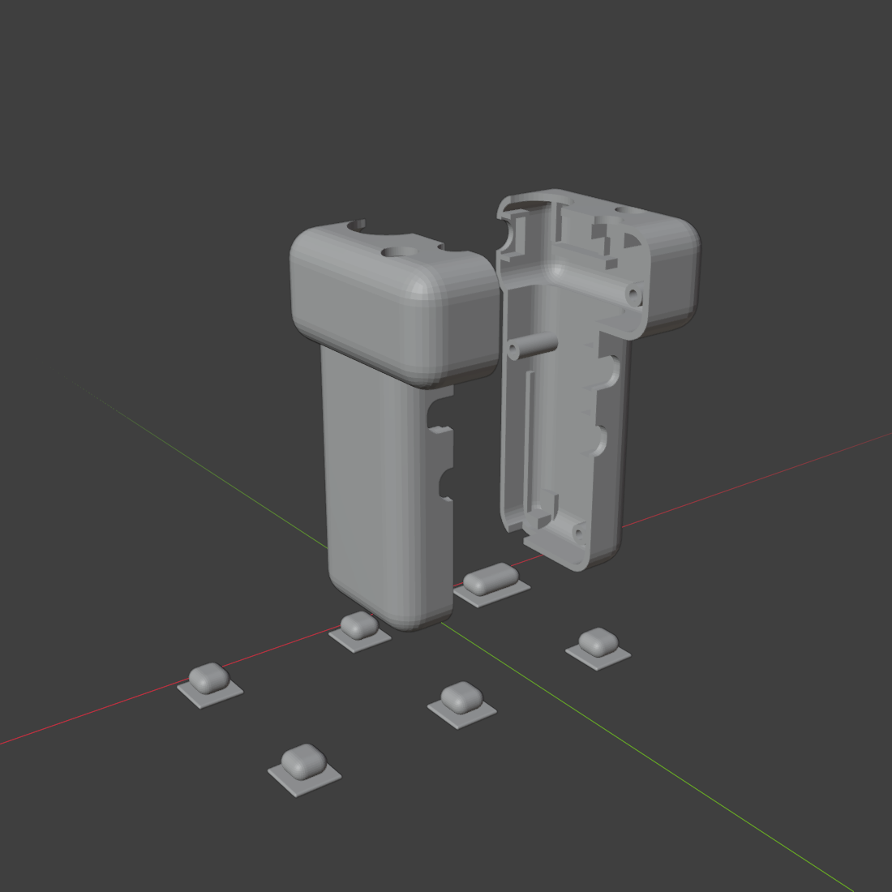
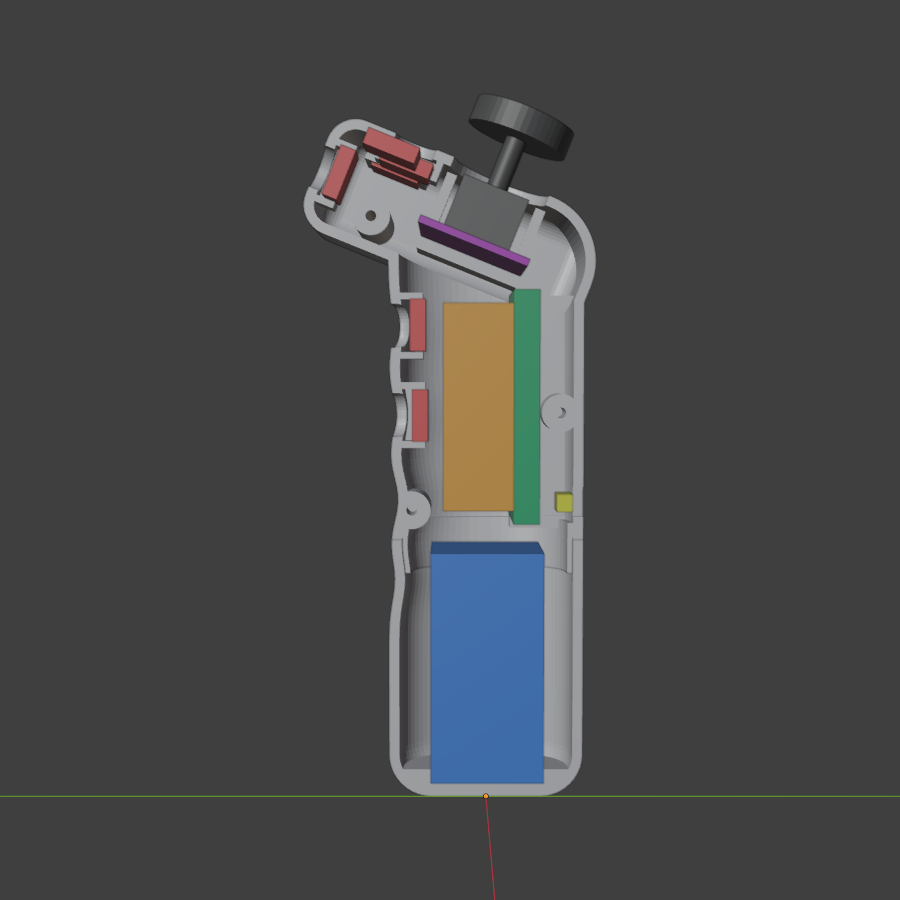
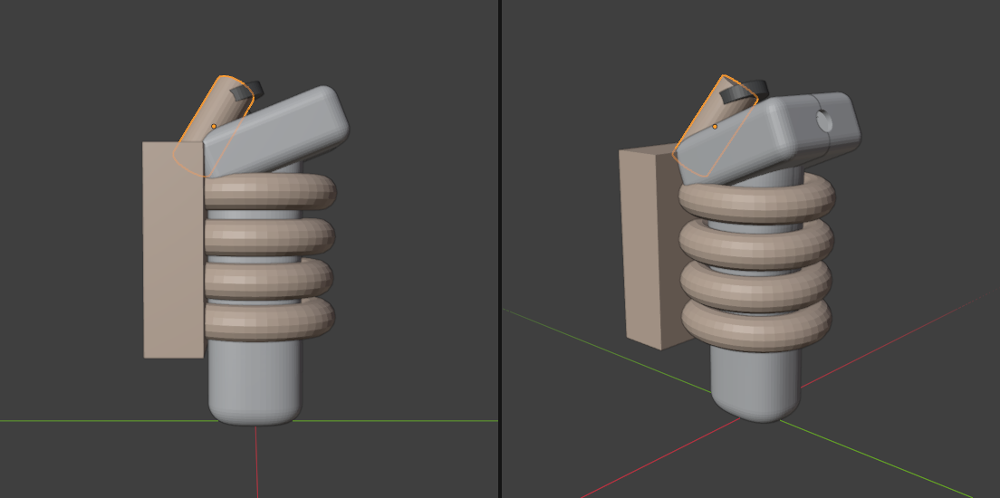

# Controle de uma mão para o shōbu em Cardboard

Uma mão segura o óculos de papelão, e a outra segura este controle. Ele é um ESP32 que se
anuncia como **gamepad BLE HID genérico**: o Android reconhece sem app, e o Chrome entrega os
botões ao jogo pela Gamepad API. Funciona com 4 pilhas AAA, que ficam no pé destacável.



| em corte, com os componentes nas medidas reais | com uma mão adulta (dedos de 17 mm) |
|---|---|
|  |  |

No corte: pilhas em azul, DevKit em verde, o espaço da perfboard e dos fios em laranja, placa do KY-023 em roxo,
táteis em vermelho e a chave em amarelo.

- `firmware/`: projeto PlatformIO do ESP32.
- `stl/`: as peças para imprimir, em mm e já na posição de impressão.
- `../../scripts/blender/controle_vr.py`: a carcaça, paramétrica. As STLs saem dela.

## A forma

- **Cabo oval** (superelipse de 41 × 48 mm na montagem em perfboard, ~45 mm de diâmetro
  equivalente): fica dentro da faixa de 30 a 50 mm da pegada de força. Tem uma cava por dedo na frente e incha 1 mm onde a
  palma fecha.
- **Cabeça baixa e inclinada 22° para trás**, com 28 mm de altura, o mínimo para o KY-023.
  O topo fica de frente para a polpa do polegar.
- **Rampa na traseira**: a quina de cima de trás é uma curva de raio 16 mm, onde o polegar
  descansa entre um movimento e outro. Da base do polegar até a capa do analógico são ~44 mm
  (sobe 37, avança 20); um polegar adulto tem ~60 mm.
- **O gatilho fica o mais alto que a aba deixa**: sobram ~6 mm entre o indicador e a aba da
  cabeça. A luneta fica 21 mm abaixo, no médio. O pulo, o botão mais usado, está 21,5 mm à
  frente do analógico.
- **O recentrar fica na face da frente da cabeça**, para o indicador levantado de propósito.
  Atrás, o polegar o apertaria sem querer toda vez que voltasse à rampa.
- **O pé é a tampa das pilhas**: sai puxando e volta encaixando, com duas travas de pressão.
  O controle tem ~160 mm de altura (165 com a capa do analógico), e ~40 mm ficam abaixo do
  mínimo: o DevKit não cabe ao lado das pilhas, só em cima delas.
- **Serve para as duas mãos**: o desenho é simétrico.

## Material

| item | qtd | observação |
|---|---|---|
| ESP32 DevKit 30 pinos (53 × 28 × 13 mm) | 1 | o de 38 pinos também cabe (`--devkit 38`) |
| KY-023 (analógico com clique) | 1 | alimentado em **3V3**, não em 5 V |
| botão tátil 12 × 12 mm | 6 | ou 6 × 6 mm (gerar a carcaça com `--botao 6`) |
| suporte para 2 pilhas AAA com fio (53 × 24,5 × 13 mm) | 2 | colados costas com costas no pé, ligados em série |
| pilha AAA NiMH recarregável | 4 + 4 | um jogo no controle e outro carregando |
| chave deslizante SS12D00 (8,6 × 3,6 mm) | 1 | liga e desliga as pilhas |
| resistor 100 kΩ e 68 kΩ | 1 + 1 | o divisor que mede as pilhas |
| placa perfurada (perfboard) | 1 | ~45 × 25 mm, à frente do DevKit: o GND comum, o divisor e os fios dos botões |
| fio flexível fino (AWG 26–28) | ~2 m | soldado direto nos pinos do DevKit, sem jumper |
| parafuso M3 auto-atarraxante | 3 | 2 × M3×20 (cabo) e 1 × M3×30 (cabeça) |
| cola quente | — | fixa o DevKit, os suportes de pilha, a chave e o fundo dos táteis |

## Energia

**4 pilhas AAA em série, ligadas no VIN do DevKit por uma chave.** O regulador do próprio
DevKit (AMS1117) faz os 3,3 V. Ele precisa de ~4,4 V na entrada, e 4 NiMH dão 4,8 V.

Por que esta solução, e não uma pilha só como o controle do Quest:

- **Consumo**: o ESP32 conectado por BLE puxa ~130–140 mA. O controle do Quest puxa poucos
  mA, e por isso dura meses com uma AA.
- **1 AA + elevador de tensão**: o elevador que dá conta (Pololu U1V11F3) é importado, e a
  pilha duraria ~3 h. Fica no limite e arrisca o prazo.
- **1 pilha 14500 de lítio**: o regulador certo (AP2112K) é SMD e importado, o HT7333 que se
  acha fácil só entrega 250 mA, e muitas 14500 vendidas como "3000 mAh" têm ~800 mAh.
- **4 AAA**: não precisa de módulo, não usa lítio, não tem importação nem solda SMD, e tudo se
  compra em qualquer loja. Se a recarregável acabar na feira, uma alcalina comprada na hora
  resolve (6 V é seguro no VIN).
- **Duração**: ~6 h com NiMH de ~900 mAh. Com o CPU a 80 MHz (o firmware já faz isso), um
  pouco mais.

O firmware mede as pilhas pelo GPIO 36 e manda o nível pelo serviço de bateria do BLE. O
Android mostra a porcentagem no menu de Bluetooth, ao lado de **shobu-controle**. O 0% fica em
4,4 V, que é onde o regulador do DevKit para de regular, e não no fim químico das pilhas.

**Antes de ligar o USB do DevKit para gravar, desligue a chave.** O USB e as pilhas
alimentam o mesmo trilho, e com os dois ligados o USB empurra corrente para dentro das pilhas.

## Ligação

Todo botão vai **entre o pino e o GND**. O firmware liga o pull-up interno, então não há
resistor nos botões.

| componente | pino do componente | pino do ESP32 | por quê este pino |
|---|---|---|---|
| pilhas (+) | → chave → | VIN | o regulador do DevKit faz os 3,3 V |
| pilhas (−) | — | GND | |
| divisor | VIN → 100 kΩ → **GPIO 36** → 68 kΩ → GND | GPIO 36 | ADC1, só-entrada; leva 6,4 V a 2,6 V |
| KY-023 | GND | GND | |
| KY-023 | +5V | **3V3** | o ADC do ESP32 satura em ~3,1 V |
| KY-023 | VRx | GPIO 34 | ADC1: o ADC2 não funciona com o rádio ligado |
| KY-023 | VRy | GPIO 35 | ADC1 |
| KY-023 | SW (clique = correr) | GPIO 25 | |
| tátil gatilho (tiro) | — | GPIO 32 | |
| tátil dedo médio (luneta) | — | GPIO 33 | |
| tátil polegar, frente (pulo) | — | GPIO 26 | |
| tátil polegar, direita (recarga) | — | GPIO 27 | |
| tátil polegar, esquerda (agachar) | — | GPIO 14 | |
| tátil na frente da cabeça (recentrar) | — | GPIO 13 | |

Os pinos 0, 2, 12 e 15 ficam de fora: são de *strapping*, e um botão apertado no boot muda o
modo de inicialização do chip.

```
   4 × AAA (+) ──[chave]──┬──────────── VIN
                          │
                        100 kΩ
                          ├──────────── GPIO 36
                         68 kΩ
                          │
   4 × AAA (−) ───────────┴──────────── GND

                 ESP32 DevKit
              ┌───────────────┐
   KY 3V3 ────┤ 3V3       GND ├──── GND comum (pilhas, KY, todos os botões)
   KY VRx ────┤ 34        VIN ├──── pilhas, depois da chave
   KY VRy ────┤ 35         36 ├──── meio do divisor
  [tiro]──────┤ 32            │
 [luneta]─────┤ 33            │
  KY SW ──────┤ 25            │
  [pulo]──────┤ 26            │
 [recarga]────┤ 27            │
 [agachar]────┤ 14            │
 [recentrar]──┤ 13            │
              └──────┬────────┘
                   USB-C (gravação; fica acessível tirando o pé)

  [x] = tátil: um terminal no pino, o outro no GND
```

## Contrato com o jogo

O Android traduz o botão HID `n` para `KEYCODE_BUTTON_*`, e o Chrome entrega isso em
`mapping: "standard"`. O jogo lê os **índices** da coluna da direita. Mudar um número no
firmware sem mudar no cliente deixa o botão mudo.

| ação | pino | botão HID (firmware) | índice standard (jogo) |
|---|---|---|---|
| pulo | 26 | 1 (A) | 0 |
| agachar / slide | 14 | 2 (B) | 1 |
| recarga | 27 | 4 (X) | 2 |
| luneta | 33 | 7 (L1) | 4 |
| tiro | 32 | 8 (R1) | 5 |
| recentrar a visão (toque) / sair do óculos (segurar ~1 s) | 13 | 12 (START) | 9 |
| correr (clique do analógico) | 25 | 14 (THUMBL) | 10 |
| andar | 34 / 35 | eixos X / Y | `axes[0]` / `axes[1]` (y positivo = trás) |

L2 e R2 ficam de fora de propósito: o Chrome Android pode tratá-los como eixo de gatilho, e o
tiro não pode depender de como cada versão decide isso.

O jogo aceita também um controle de xbox ou playstation, no mesmo mapping. Além da tabela,
ele lê o que este controle não tem: R2 e L2 (índices 7 e 6) repetem tiro e luneta, Y
(índice 3) segura o gancho, o R3 (índice 11) é a lâmina e o ↑ do direcional (índice 12) volta dela à sniper, e o analógico direito (`axes[2]` / `axes[3]`) olha — no óculos,
só gira o corpo para os lados. Segurar VIEW/SHARE (índice 8) mostra o placar. Este controle
ainda não tem botão de gancho: ganhar um é ligar um botão novo ao HID 5 (Y), sem mudar nada
no jogo.
No menu, A confirma, B volta, e o direcional (12 a 15) ou o analógico esquerdo andam. O
mapa completo está no jogo, em CONFIGURAÇÕES → MAPA DO CONTROLE, junto com a sensibilidade
do analógico, o vertical invertido e a vibração.

## Gravar o firmware

Desligue a chave das pilhas, tire o pé e ligue o cabo USB-C pelo pescoço.

```sh
cd hardware/controle-vr/firmware
pio run -t upload          # ou: uvx platformio run -t upload
pio device monitor         # mostra a calibração do analógico e o nível da bateria
```

**Não mexa no analógico ao ligar.** O firmware lê o centro dele nos primeiros ~130 ms. Se o
personagem andar sozinho, desligue e ligue de novo com o analógico solto. Se um eixo sair
invertido porque o módulo ficou girado na carcaça, troque `INVERT_X` ou `INVERT_Y` no
`main.cpp`, em vez de trocar os fios.

## Parear e testar no Android

1. Ligue a chave e abra Configurações → Bluetooth → parear **shobu-controle**.
2. No Chrome do celular, abra um testador de gamepad (por exemplo hardwaretester.com/gamepad)
   e confira se cada botão acende o índice da tabela acima.
3. Para ver os números exatos, ligue o celular por USB e use `chrome://inspect` no computador.
   No console da página, rode `navigator.getGamepads()[0]`.

## Imprimir

| peça | qtd | posição |
|---|---|---|
| `metade-esquerda.stl` | 1 | já sai deitada na face do corte. Não precisa de suporte |
| `metade-direita.stl` | 1 | idem |
| `pe-das-pilhas.stl` | 1 | em pé, boca para cima. A curva do fundo pode pedir suporte só na borda |
| `tecla-*.stl` | 6 | flange para baixo |

- **Material**: PLA. As travas do pé têm só 0,4 mm de saliência, porque o PLA racha antes de
  flexionar. Se o pé sair fácil demais, aumente `TRAVA["saliencia"]` aos poucos (0,1 mm por
  vez); se for difícil de tirar, lixe as duas travas do pescoço.
- **Camadas**: 0,2 mm, com 6 perímetros (a parede tem 2,4 mm) e 20% de preenchimento.
- **Folga**: os furos e o encaixe do pé têm 0,3 mm de folga para FDM. Se a tecla ficar justa,
  lixe a haste antes de alargar o furo.
- **Primeiro teste**: imprima uma tecla e o pé primeiro. São as peças rápidas, e elas mostram
  se a folga da sua impressora bate com a do desenho.

## Montar

1. Cole os dois suportes de pilha costas com costas no piso do pé e ligue-os em série. Os
   dois fios sobem pelo pescoço, com folga para o pé sair sem puxar a solda.
2. Encaixe as teclas por dentro, com o flange contra a parede.
3. Ponha os táteis nas molduras atrás das teclas e fixe o fundo com cola quente ou com um
   pedaço de perfboard.
4. Apoie a placa do KY-023 nas duas prateleiras da cabeça, com a alavanca saindo pelo furo
   grande. Os quatro pinos do teto prendem a placa quando a carcaça fecha.
5. O DevKit fica de pé acima do pé, com a USB-C para baixo e os componentes virados para trás,
   encostados nas duas costelas, com a ponta de baixo nos dois apoios. Prenda com cola quente.
6. Cole a chave atrás, com a alavanca na fenda logo acima da junta do pé. Solde o divisor
   direto nos fios.
7. Ligue os fios pela tabela e feche as metades com os 3 parafusos. A cabeça do parafuso fica
   do lado direito, embutida no rebaixo.
8. Encaixe o pé no pescoço até as travas estalarem.

## Medidas a conferir com o paquímetro

A carcaça foi desenhada sem as peças na mão. O script confere o encaixe: `--conferir 1` põe
dentro das peças volumes com as medidas abaixo e informa, em mm³, quanto de cada um bate numa
parede. Zero significa que cabe. Ele confere o DevKit, o espaço da perfboard, a placa e o cardan do
KY-023, os seis táteis, o bloco das pilhas e a chave. A protoboard não entra nessa
conferência.

Antes de imprimir, meça estes valores e ajuste-os no topo de `scripts/blender/controle_vr.py`:

| parâmetro | valor usado | o que medir |
|---|---|---|
| `DEVKITS` | 53 × 28,5 (30 pinos, medido), 55 × 28,5 (38) | comprimento e largura da placa |
| `DEVKIT_ESPESSURA_COMPONENTES` | 4,5 mm | da placa ao topo da blindagem do módulo |
| `PILHAS` | 53 × 24,5 × 26 mm | os dois suportes de 2 AAA, juntos |
| `CHAVE_CORPO` | 8,6 × 3,6 × 4 mm | o corpo da chave deslizante |
| `KY_PLACA` | 34 × 26 mm | a placa do KY-023 |
| `KY_ALAVANCA_DESLOCAMENTO` | 3,5 mm | do centro da alavanca ao centro da placa, no comprimento |
| `KY_CARDAN_ALTURA` | 15 mm | do fundo da placa ao topo do cardan |
| `BOTOES` | corpo 12, tecla 10 | o corpo do tátil |

Depois de ajustar, confira e regenere as STLs:

```sh
blender -b -P scripts/blender/controle_vr.py -- --conferir 1 --saida hardware/controle-vr/stl
# outras montagens:
blender -b -P scripts/blender/controle_vr.py -- --montagem protoboard170 --devkit 38 --saida ...
```

## Montagem do circuito

**Decidido: perfboard soldada**, a mais robusta para um dia inteiro de feira (jumper solta
com o controle sacudindo). A STL versionada é a de `perfboard`, e o script é o padrão nela.

A perfboard fica de pé à frente do DevKit, no espaço que a conferência reserva para os fios
(16 mm). Nela ficam o GND comum dos botões, o divisor da bateria e as emendas. Os fios saem
dela soldados direto nos pinos do DevKit, sem conector.

O script ainda gera as outras duas montagens, se um dia precisar:

- `fios`: jumpers fêmea direto nos pinos. Sem solda, cabo de 39 × 46 mm.
- `protoboard170`: a protoboard de 170 furos à frente do DevKit. Sem solda, mas o cabo
  engrossa para 47 × 56 mm, o que já é grosso para mão pequena.
